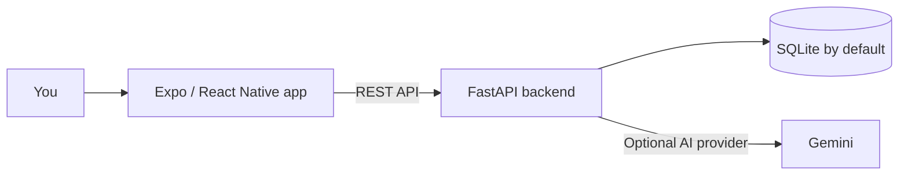

<div align="center">
  

  <h1>HabitGame</h1>

  <h3>Small steps. Stronger habits. A healthier you.</h3>

  Build routines, notice your progress, and make room for a little growth every day.

  <p>
    <a href="https://github.com/rajrishabh23959-oss/HABBIT-TRACKER">
      
    </a>
    
    
    
  </p>

  <p>
    <a href="#-get-started">Get started</a> ·
    <a href="#-features">Explore features</a> ·
    <a href="#-api">API</a> ·
    <a href="#-contributing">Contribute</a>
  </p>
</div>

---

## 🌱 About

**HabitGame** is a habit and wellness tracker built with an Expo / React Native app and a FastAPI backend. Track the routines you want to grow, reflect on your wellbeing, and use progress insights to keep moving forward—one day at a time.

The app is organized around five tabs: **Habits**, **Garden**, **Stats**, **Anti-Habit**, and **Community**. Sign in or create an account to get started.

## ✨ Features

| | Feature | What it does |
|---|---|---|
| ✅ | **Daily habit tracking** | Create habits, mark daily progress, and review your month at a glance. |
| 🌿 | **Virtual garden** | See your positive habits represented as plants that grow with your progress. |
| 📊 | **Progress insights** | Explore habit analytics, streaks, and personalized insights. |
| 🧘 | **Wellness & mood** | Log wellness information and check in with your mood. |
| 🔗 | **Habit stacking** | Connect a new routine to an existing one to make it easier to remember. |
| 🛡️ | **Anti-habit support** | Track urges and review your progress as you work to change unwanted patterns. |
| 🤝 | **Community** | Find accountability and group features, including a leaderboard. |
| 💚 | **Kindness challenges** | Take on small acts of kindness and keep a kindness streak. |
| 🤖 | **AI chat** | Get conversational habit support through the app’s AI chat experience. |
| 🔔 | **Mobile extras** | Uses Expo notifications, location, and sharing capabilities where supported. |

## 🖼️ A look at the app

<div align="center">
  
  <br />
  <em>HabitGame — grow a little every day.</em>
</div>

> **Screenshots welcome!** The repository currently includes app artwork, but not captured in-app screenshots. Add screenshots to `frontend/assets/` and link them here when available.

## 🧭 How it fits together



### Technology

- **Mobile and web app:** React Native, Expo, React Navigation, Zustand
- **API:** Python, FastAPI, SQLAlchemy, Pydantic
- **Database:** SQLite by default; `DATABASE_URL` can point to another SQLAlchemy-supported database
- **AI:** Optional Gemini-powered suggestions and coaching; the backend reads `GEMINI_API_KEY`

## 🚀 Get started

### Prerequisites

- Python and pip
- Node.js and npm
- Expo Go for running on a physical device (optional)

### 1. Start the backend

In a terminal:

```bash
cd backend
python -m venv .venv
```

Activate the virtual environment:

```bash
# macOS / Linux
source .venv/bin/activate

# Windows PowerShell
.\.venv\Scripts\Activate.ps1
```

Install dependencies and run the API:

```bash
pip install -r requirements.txt
python run.py
```

The API is available at `http://localhost:8000`. Interactive API documentation is at [`http://localhost:8000/docs`](http://localhost:8000/docs), and the health check is [`http://localhost:8000/health`](http://localhost:8000/health).

### 2. Start the app

Open a second terminal:

```bash
cd frontend
npm ci
npm start
```

Use the Expo CLI to open the app on a simulator or device. You can also start a platform-specific session:

```bash
npm run android
npm run ios
npm run web
```

By default, the app sends API requests to `http://localhost:8000/api/v1`. For a phone on your local network, set `EXPO_PUBLIC_API_URL` to your computer’s reachable address, for example:

```bash
# Windows PowerShell
$env:EXPO_PUBLIC_API_URL = "http://192.168.1.25:8000/api/v1"
npm start
```

Replace the example address with your machine’s LAN IP. The phone and computer must be able to reach each other on the network.

## ⚙️ Configuration

The backend reads environment values from `backend/.env` (or from the process environment). Create that file when you need custom settings:

```dotenv
DATABASE_URL=sqlite:///./habitgame.db
SECRET_KEY=replace-with-a-long-random-secret
ALGORITHM=HS256
ACCESS_TOKEN_EXPIRE_MINUTES=10080
GEMINI_API_KEY=
```

`GEMINI_API_KEY` is optional for backend AI features. Use your own provider key, keep it private, and never commit `.env` files or real credentials. The frontend API address can be configured with `EXPO_PUBLIC_API_URL` as shown above.

## 🔌 API

The versioned API is mounted at `/api/v1`. The interactive FastAPI documentation at `/docs` lists the full request and response schemas.

| Route group | Prefix | Examples |
|---|---|---|
| Authentication | `/auth` | Register and log in |
| Habits | `/habits` | Dashboard, toggle, create, garden, analytics insights |
| Wellness | `/wellness` | Wellness logs |
| Mood & stacking | `/mood` | Mood check-ins and habit stacks |
| Anti-habits | `/anti-habits` | Anti-habits, urge logs, and stats |
| Community | `/social` | Accountability, groups, and ghost status |
| Kindness | `/kindness` | Daily challenge, completion, and streak |
| AI chat | `/chat`, `/ai` | Chat endpoints |

## 🗂️ Project structure

```text
.
├── backend/
│   ├── app/
│   │   ├── api/          # Versioned FastAPI routes
│   │   ├── core/         # Settings and security
│   │   ├── db/           # SQLAlchemy engine and sessions
│   │   ├── models/       # Database models
│   │   ├── schemas/      # API schemas
│   │   └── services/     # Habit, analytics, wellness, and AI logic
│   ├── requirements.txt
│   └── run.py
└── frontend/
    ├── assets/           # App icons and artwork
    └── src/
        ├── components/
        ├── navigation/
        ├── screens/
        ├── store/
        ├── theme/
        └── utils/
```

## 🔐 Privacy & security

- Keep API keys, signing secrets, personal data, and local database files out of version control.
- Set a unique, sufficiently strong `SECRET_KEY` outside local development.
- Do not use a development server exposed to the public internet as a production deployment.

## 🤝 Contributing

Contributions and ideas are welcome:

1. Fork the repository.
2. Create a branch for your change.
3. Make and test your changes locally.
4. Open a pull request with a clear description.

## 📄 License

The repository includes an MIT license file at [`frontend/LICENSE`](./frontend/LICENSE). Review its notice and the applicable third-party licenses before reusing code or assets; add a root-level license if you intend it to define terms for the entire project.

---

<div align="center">
  <strong>Make progress feel possible—one small habit at a time. 🌱</strong>
  <br />
  <sub>Built with care for everyday growth.</sub>
</div>
